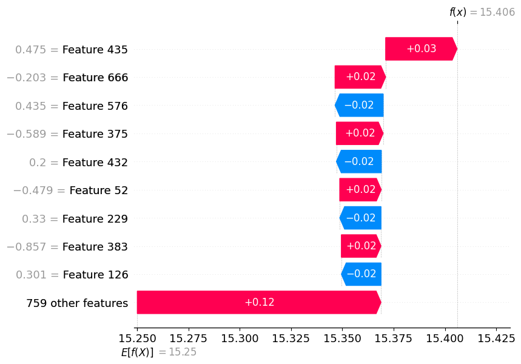

# Explainable Automated Essay Scoring with BERT and SHAP

Prototype pipeline from my MSc Data Analytics dissertation, *Applying Natural Language Processing for Automated Assessment in Education* (BSBI, Berlin, 2026).

I used to be an English teacher, so I wanted to know whether a machine can score student essays in a way teachers could trust. That means the score has to come with an explanation.

## What's inside

- `essay_scoring_bert_shap.ipynb`: the full pipeline, with outputs
- `student_essays_dataset.xlsx`: a small sample of short essays on AI in education, each with a human score
- `shap_waterfall.png`: example SHAP output from the notebook

## Pipeline

1. **Preprocessing (NLTK):** lowercasing, cleaning, tokenisation, stop-word removal, lemmatisation
2. **Linguistic features (textstat):** word count, sentence count, lexical diversity, Flesch readability
3. **Baseline model:** TF-IDF features → linear regression, evaluated with MSE, Pearson correlation and 5-fold cross-validation
4. **Transformer model:** BERT (`bert-base-uncased`) mean-pooled embeddings → regression
5. **Explainability (SHAP):** summary and waterfall plots showing which inputs push a score up or down

## Example output

*SHAP waterfall plot for one test essay. It starts from the average predicted score (15.25) and shows how each input moves the prediction to its final value (15.41).*

In this prototype the inputs are the 768 BERT embedding dimensions ("Feature 435" and so on), which have no meaning a teacher could read. The plot shows that the explanation step works technically. To make it useful in a classroom, the next step is to explain scores in terms of readable features such as essay length, vocabulary range and readability, or the individual words in the essay.

## A note on the data

This notebook runs on a small demonstration sample (10 essays) so the whole pipeline is easy to follow and quick to run. With a test set this small, the evaluation numbers aren't meaningful. The point of this notebook is the method, not the scores. A real evaluation needs a large labelled dataset, such as the public ASAP essay set.

The dissertation also included a survey and interviews with teachers about whether they would trust explainable AI scoring. The main finding was that they would trust it for formative feedback, with humans still in charge of high-stakes grading.

## How to run

1. Open the notebook in Google Colab.
2. Upload `student_essays_dataset.xlsx` to the Colab file panel (it is read from `/content/`).
3. Run all cells. The `pip install` cells install NLTK, textstat, Transformers, PyTorch and SHAP.

**Tools:** Python, Pandas, NLTK, textstat, scikit-learn, Hugging Face Transformers (BERT), PyTorch, SHAP, Google Colab
